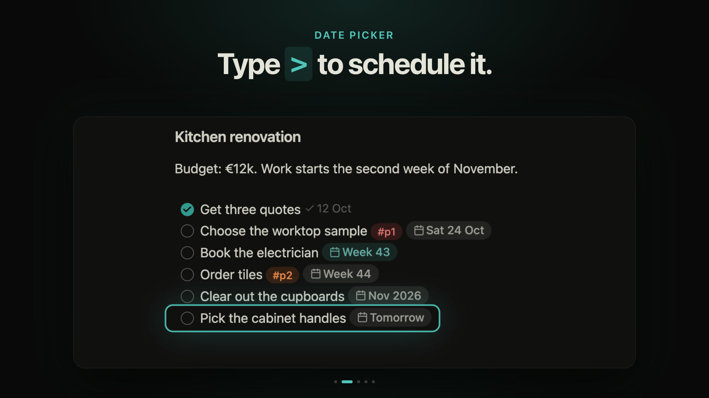
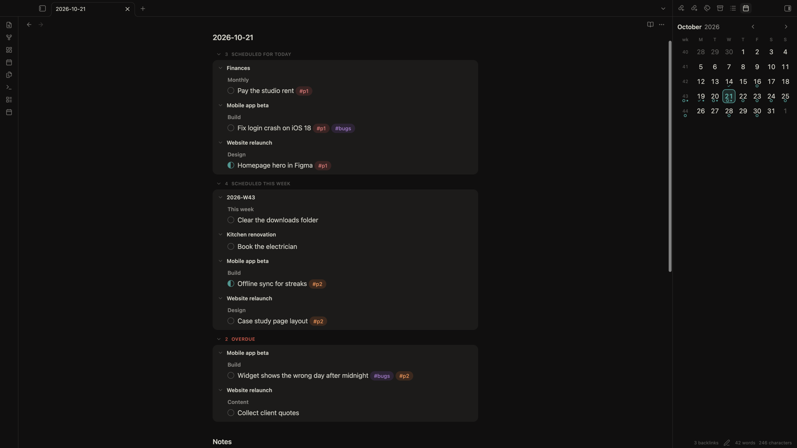
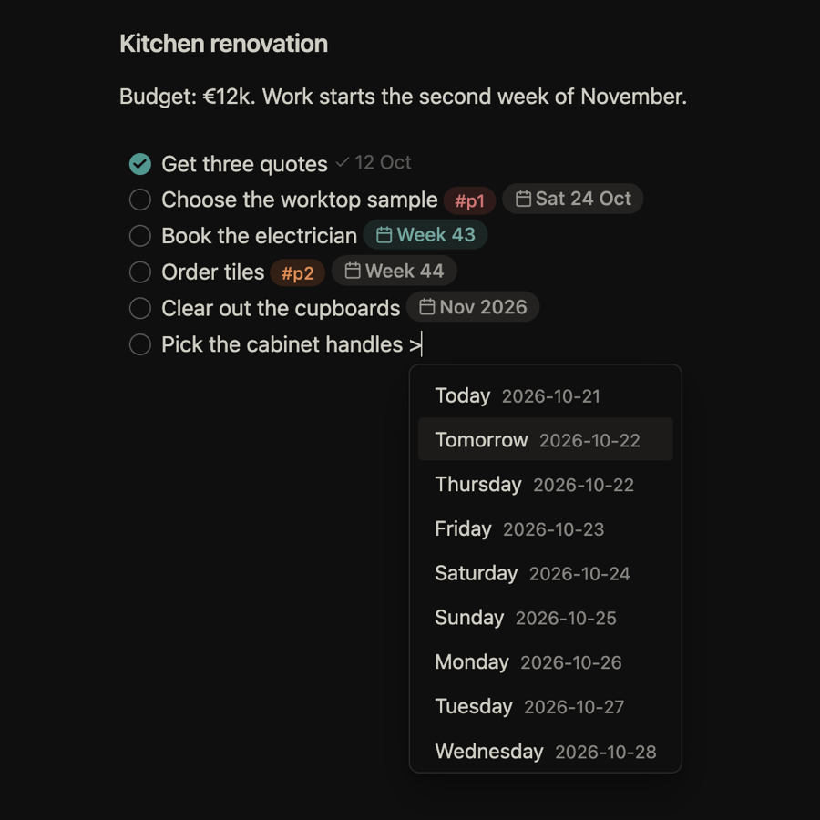
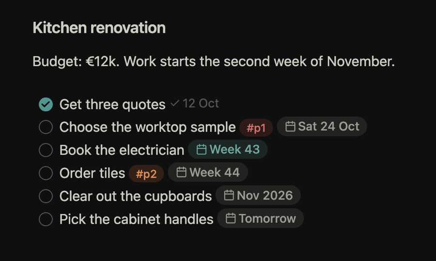
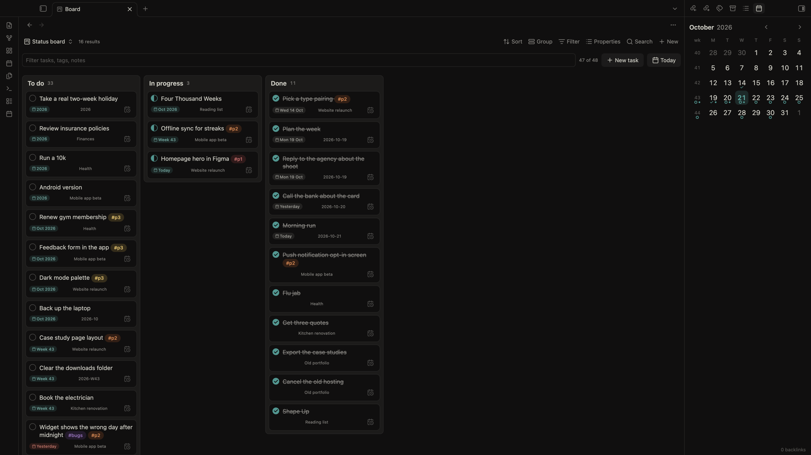

# Klaar (beta)

Tasks and periodic notes for Obsidian. Your tasks stay plain Markdown checkboxes in your own notes: type `>` to schedule one, and it shows up in that day's, week's, month's or year's note.

[](assets/video/klaar-tour.mp4)

> [!WARNING]
> Klaar is in beta, so things may still change and you may hit bugs. It only edits the task lines you act on, but keep a backup of your vault and please [report problems](https://github.com/i-am-fran/obsidian-klaar/issues).

## Install

Requires Obsidian 1.13.0 or newer.

- **BRAT (recommended during beta):** add `i-am-fran/obsidian-klaar` in the BRAT plugin and enable Klaar.
- **Manual:** copy `main.js`, `manifest.json` and `styles.css` from the [latest release](https://github.com/i-am-fran/obsidian-klaar/releases) into `<vault>/.obsidian/plugins/klaar/`, then enable Klaar in Settings → Community plugins.

## What it does



- **Schedule with `>`.** On a task line, type `>` and pick Today, Tomorrow, a weekday, a week, a month, a quarter or a year. Klaar writes a link like `>[[2026-10-23]]` or `>[[2026-W43]]`. "Move task to…" does the same from the command palette or right-click menu.
- **Period notes show what's due.** Day, week, month, quarter and year notes list the tasks scheduled for them, plus the ones from the period above and below, and Overdue on today's note. Tick a task there and its source note updates. Nothing is written into the note.
- **Calendar.** A sidebar month view with week numbers. Click a day or week to open its note, drag a task onto a day to reschedule it.
- **Tags and priority.** `#p1`, `#p2`, `#p3` and `#bugs` (or your own tags) become coloured pills. Commands cycle priority and toggle in progress.
- **Date chips.** `>[[2026-10-23]]` reads as `Fri 23 Oct`, `Today` or `Week 43`, red when overdue.
- **Bases views.** "Klaar Table" and "Klaar Board" show the tasks of any base. Drag a card to Done, In progress, a priority or a date column and Klaar rewrites just that line.

<p>
   on a task line opens the date picker with Today, Tomorrow and the next weekdays" width="49%">
  
</p>



## Task syntax

| Line | Meaning |
|---|---|
| `- [ ] text` | open |
| `- [x] text` | done (Klaar can add ` (@done [[YYYY-MM-DD]])`) |
| `- [/] text` | in progress |
| `- [>] text` | next |
| `- [<] text` | someday |
| `- [-] text` | cancelled |

Schedule keys: `2026-10-19` (day), `2026-W43` (ISO week, Monday start), `2026-10` (month), `2026-Q4` (quarter), `2026` (year). A task written in a period note without a `>` link belongs to that note's period. Any other marker, such as `[!]`, isn't a Klaar task and is left alone.

## Settings

Period notes folder (default `Daily`), which period types are on (quarterly is off by default), the completed date stamp, the `[/]`, `[>]` and `[<]` markers, tag colours and roles, and how date chips look.

## Support

Klaar is free. If it helps you, you can buy me a coffee:

<a href="https://www.buymeacoffee.com/iamfran" target="_blank"></a>

## Development

```
npm install
npm run dev     # watch build to main.js
npm run build   # type-check and production build
npm test        # vitest
npm run lint    # eslint
```

To release, bump the version with `npm version <version> --no-git-tag-version` and add a `## <version>` section to `CHANGELOG.md`. When that reaches `main`, the Release workflow tags it and publishes the release.

MIT licensed.
