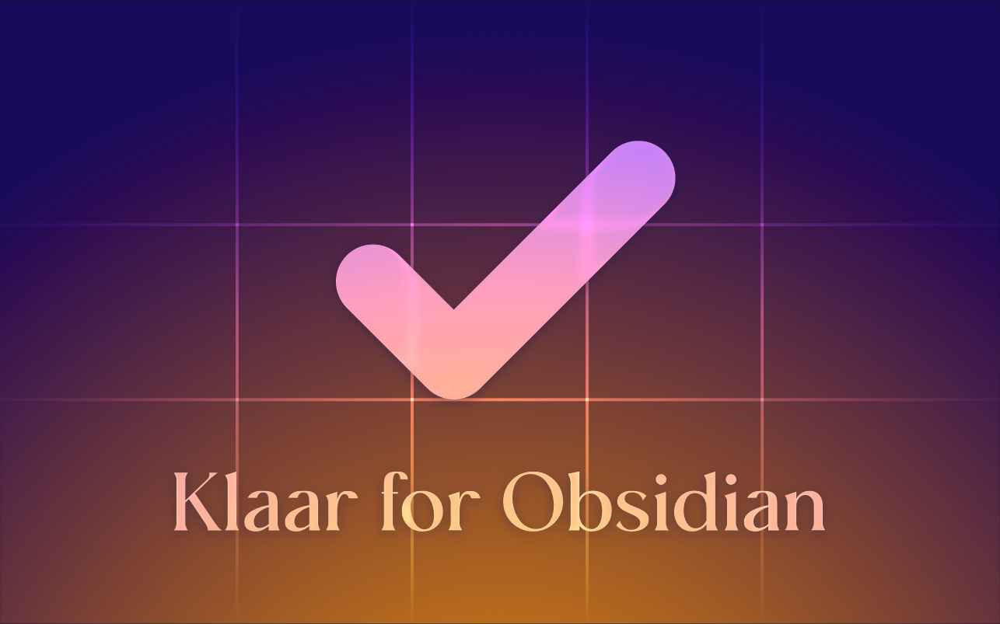
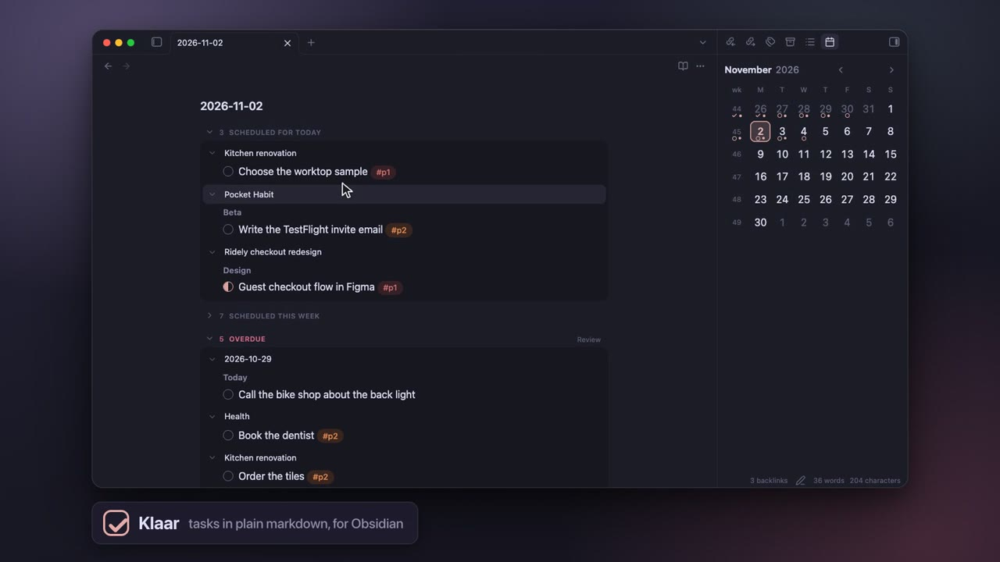
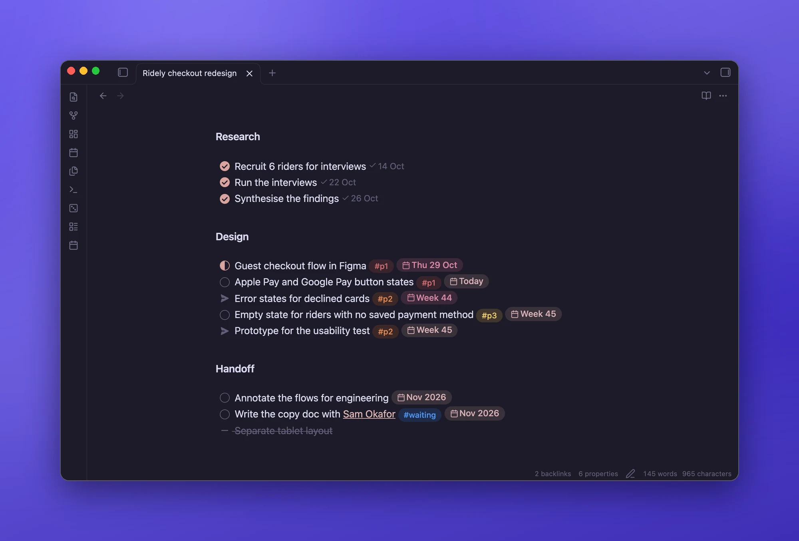
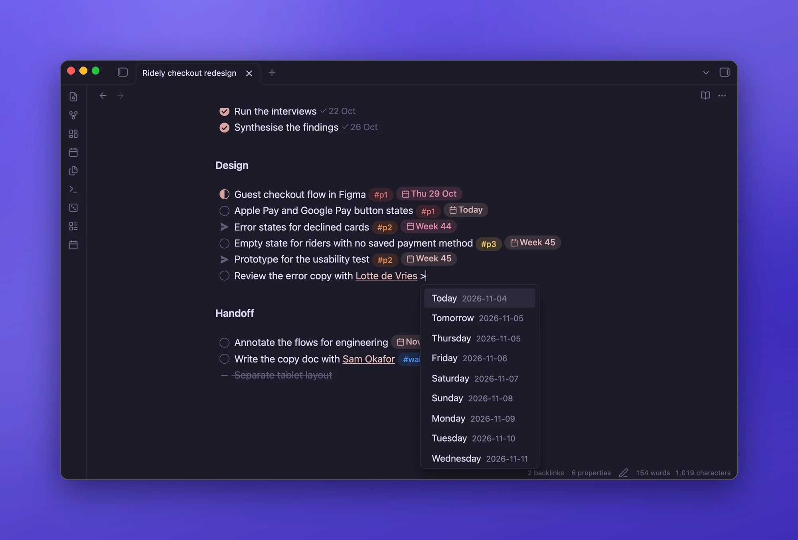
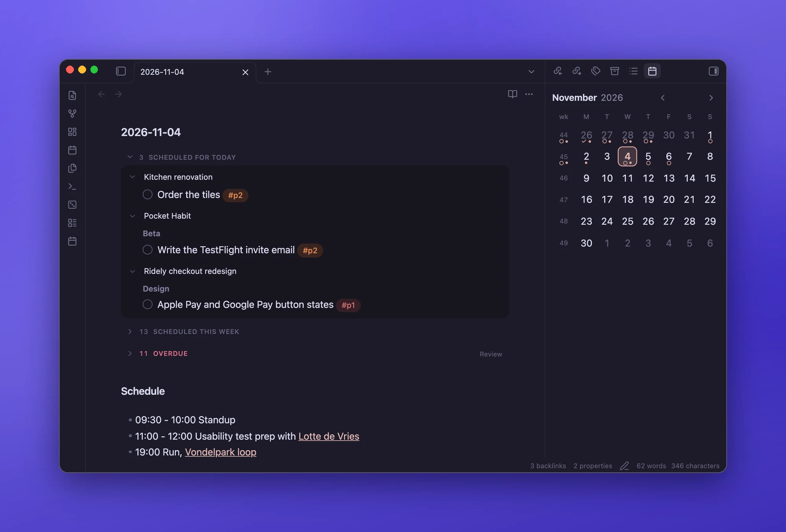
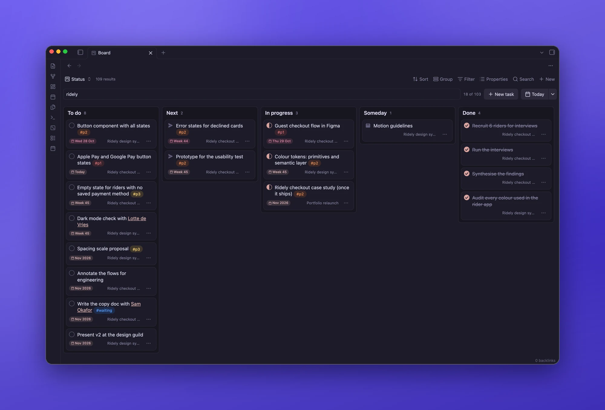
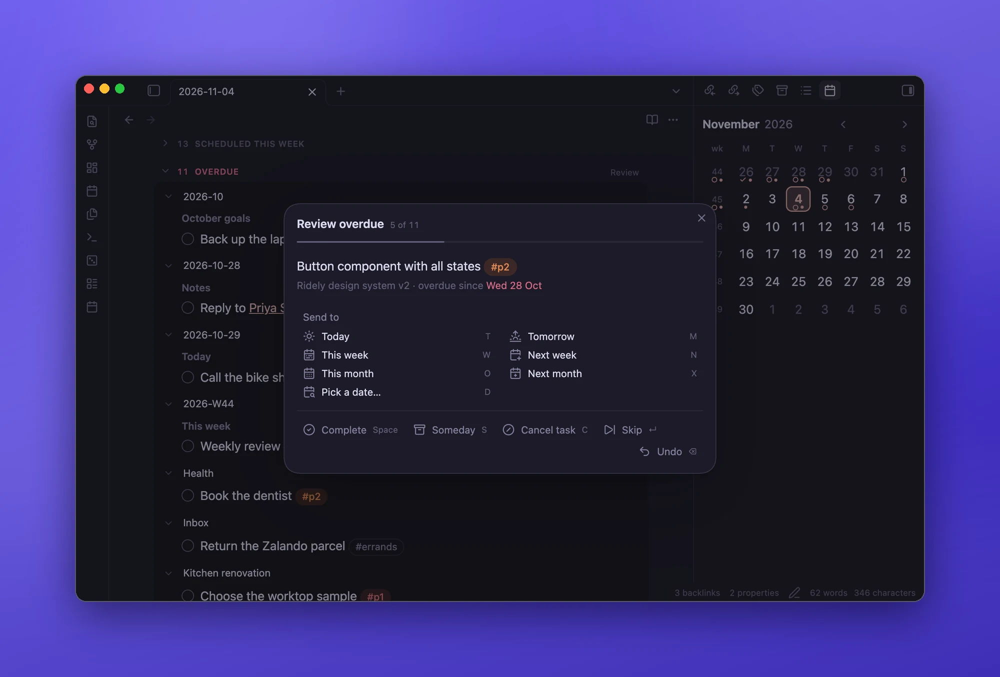

# Klaar

[](assets/video/klaar-intro.mp4)

Klaar is a small task manager for Obsidian. Write tasks as normal checkboxes in any note, give them a day, week, month or year, and they show up in your journal notes.

- **[Install in Obsidian](https://obsidian.md/plugins?id=klaar)**
- **[Documentation](https://i-am-fran.github.io/obsidian-klaar/)**
- **[Report a bug](https://github.com/i-am-fran/obsidian-klaar/issues)**

<a href="https://www.buymeacoffee.com/iamfran" target="_blank"></a>

Klaar is minimal on purpose. Your tasks stay plain Markdown checkboxes in your own notes. Klaar shows its lists when you open a journal note, and the file itself stays exactly as you wrote it. If you stop using Klaar tomorrow, nothing breaks. You'll just see a few links like `>[[2026-W43]]` at the end of some lines.

It feels like part of Obsidian rather than an app inside an app. Journal notes are just notes and the calendar is a simple sidebar. When you want a table or a board of your tasks, Klaar plugs into Bases with two views, Klaar Table and Klaar Board, instead of inventing its own query language.

In Dutch, *Klaar* means clear, and it's also what you say when something is done or ready.

## How it works

There are four ways to use Klaar, and each builds on the one before. Start with the first and add the others when you want them.

### 1. Tasks anywhere

Write a task in any note: a meeting note, a project note, today's note. Type `>` at the end of the line and pick Today, Tomorrow, a weekday, a week, a month, a quarter or a year. Klaar adds a link to that period's note:

```markdown
- [ ] Send the quarterly report #p1 >[[2026-W43]]
```

The link reads as a small chip such as `Fri 23 Oct` or `Week 43`, red when the task is overdue. Besides open and done, Klaar understands a few more markers, and tags like `#p1` become coloured pills. You decide which tags mean priority, and any of your tags, like `#waiting`, can be a column on a board.

<p>
  
   after a task opens the date picker: Today, Tomorrow and the next seven days with their dates" width="49%">
</p>

| You write | It means |
|---|---|
| `- [ ]` | to do |
| `- [x]` | done |
| `- [/]` | in progress |
| `- [>]` | next |
| `- [<]` | someday |
| `- [-]` | cancelled |

Two more are experimental and off until you turn them on under Settings → Experimental: `[?]` for a question and `[I]` for an idea. Both stay out of your day like someday tasks, and you find them under their own status in a Klaar Table or column on a board. Anything else, like `[!]`, isn't a Klaar task and is left alone.

### 2. With journal notes

This is where Klaar is strongest. Each day, week, month, quarter and year note lists the tasks planned for it, above your own text. The plans cascade: a week note also shows the month around it and each day inside it, so the bigger plans are there every time you plan. Today's note shows what's due today, what's still open this week and anything overdue, and folds the day's ticked tasks into a Done group. Tick a task there and it's ticked in the note where you wrote it. A task you write straight into a journal note, without a `>` link, belongs to that note's day, week or month.

A calendar in the sidebar, with week numbers, takes you between notes. Click a day or a week to open its note, and drag a task onto a day to move it. A ring marks days with open tasks, a check marks days where everything is done.



### 3. With Bases

Klaar Table and Klaar Board show the tasks of any base, so a base for a project folder gives you that project's tasks. Search, filter, sort and group them, and act on them where they are: tick a task, reschedule it, or drag a card to Done, In progress, a priority or a date column, and Klaar changes just that line. A board by date puts everything without a date in its own Undated column. A subtask names the task it belongs to above its text, and a task with subtasks shows how many are done.



### 4. Catching up

Every task has a ⋯ menu: Today, Tomorrow, This week, Next week, This month, Next month or any date. A task in a journal note moves into that day's or week's note, with its subtasks, and Klaar creates the note if it isn't there yet. A task in a project note stays put and gets a `>` link instead.

Back after a break? **Review overdue tasks** goes through what's overdue one task at a time, with a single key for each: T today, W this week, X next month, Space complete, S someday, C cancel. **Move open tasks to…** carries everything unfinished in an old note forward at once, and holding Alt (Option) while dragging a task onto the calendar moves it there instead of only rescheduling it.



The documentation has [every feature, including the little ones](https://i-am-fran.github.io/obsidian-klaar/docs.html#all-features). Wondering why there are no recurring tasks, times of day or stats? The [FAQ](https://i-am-fran.github.io/obsidian-klaar/docs.html#faq) explains.

## Installation

You need Obsidian 1.13.0 or newer. Klaar works on desktop and mobile.

1. In Obsidian, open Settings → Community plugins → Browse.
2. Search for **Klaar**, then install it and turn it on.
3. The calendar opens in the right sidebar. Click today to open (or create) today's note.

Other ways to install:

- **BRAT:** add `i-am-fran/obsidian-klaar` in the BRAT plugin to follow every release as soon as it's published.
- **By hand:** download `main.js`, `manifest.json` and `styles.css` from the [latest release](https://github.com/i-am-fran/obsidian-klaar/releases/latest), put them in `<vault>/.obsidian/plugins/klaar/`, and turn on Klaar in Settings → Community plugins. If you want to check the files were built from this repository, run `gh attestation verify main.js --repo i-am-fran/obsidian-klaar`.

## Settings

Under Settings → Klaar you choose the **Journal notes folder** (`Daily` by default), which period types you use, a template for each kind of new note, the extra markers, your tags and colours, and how dates look. The documentation lists [every setting and its default](https://i-am-fran.github.io/obsidian-klaar/docs.html#settings).

## Themes

Klaar works with the default Obsidian theme and with Minimal, in light and dark mode. I'll test and add support for more themes over time. If something looks off in yours, please [let me know](https://github.com/i-am-fran/obsidian-klaar/issues). With the Style Settings plugin you can also tune the tag pills and the date chip colours.

## Support

Klaar is free. If it helps you, you can buy me a coffee:

<a href="https://www.buymeacoffee.com/iamfran" target="_blank"></a>

## Development

```
npm install
npm run dev     # watch build to main.js
npm run build   # type-check and production build
npm test        # vitest
npm run lint    # eslint
```

Changes are listed in the [changelog](CHANGELOG.md).

## License

MIT. See [LICENSE](LICENSE).

## Made with AI

Part of this project has been developed with the help of AI. I'm improving my development skills and it's helping me to learn new skills and review my code. If you don't like it, I understand your stance.
